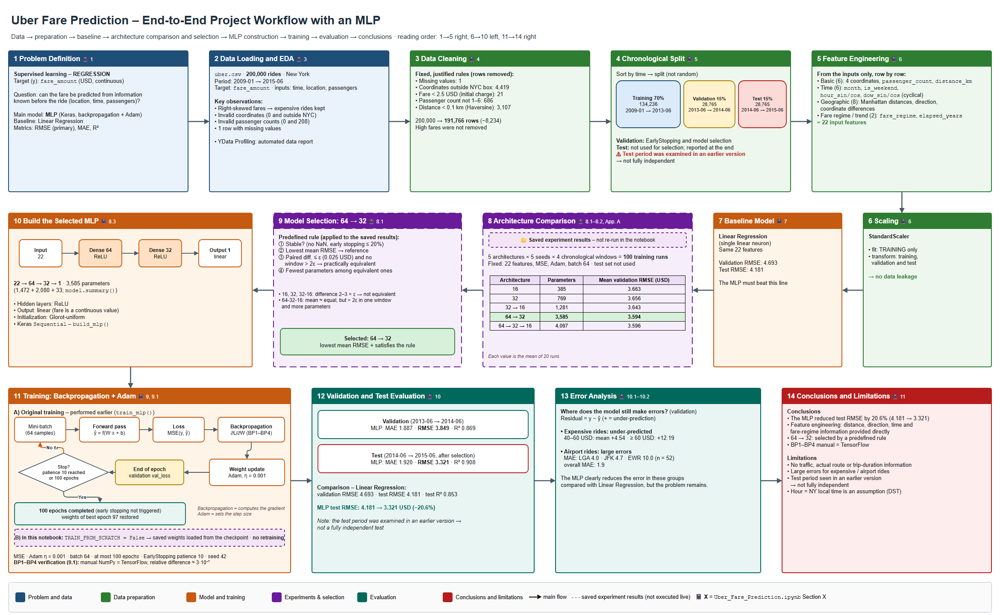
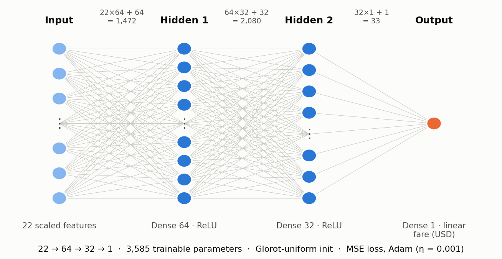
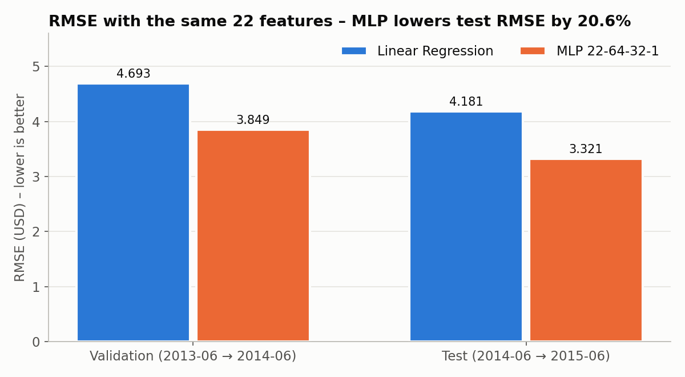
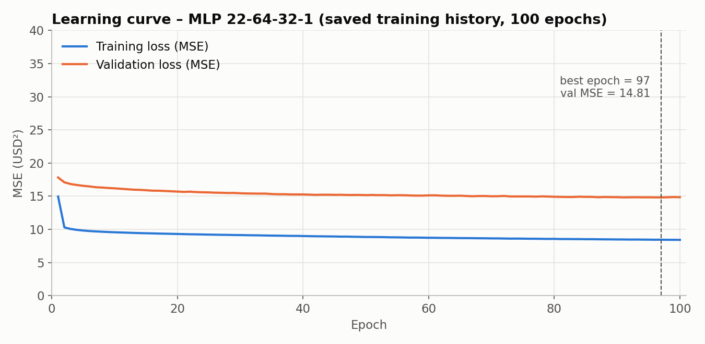
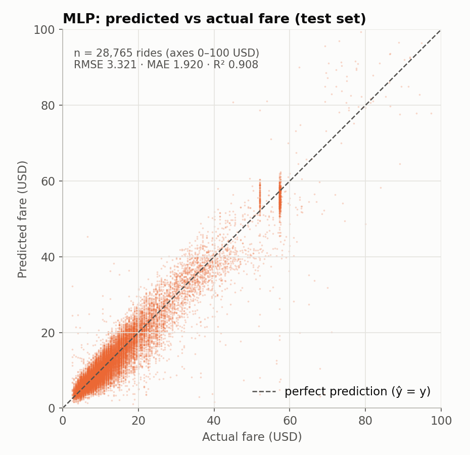

# Uber Fare Prediction using MLP

An end-to-end machine learning project for predicting ride fares using a Multi-Layer Perceptron (MLP) built with
TensorFlow/Keras. It covers data exploration, preprocessing, feature engineering, architecture comparison, neural
network training, backpropagation verification and model evaluation.



## Project overview

The goal is to predict the fare of a ride (`fare_amount`, USD) **before the ride starts**, using only the pickup time,
the pickup and drop-off coordinates and the passenger count. It is a supervised regression problem. An MLP is compared
against a Linear Regression baseline that uses exactly the same inputs, so the gain comes from the network's
non-linear hidden layers.

| | |
|---|---|
| Cleaned dataset | 191,766 rides (from 200,000) |
| Input features | 22 engineered features |
| Architecture search | 100 training runs (5 architectures × 5 seeds × 4 chronological windows) |
| Final model | **22 → 64 → 32 → 1**, 3,585 trainable parameters |
| Test RMSE | **3.321 USD**, compared with 4.181 USD for Linear Regression (**−20.6%**) |

The complete analysis is in [`Uber_Fare_Prediction.ipynb`](Uber_Fare_Prediction.ipynb).

## Dataset

[Uber Fares Dataset](https://www.kaggle.com/datasets/yasserh/uber-fares-dataset) on Kaggle (listed under CC0: Public
Domain). It contains about 200,000 Uber rides in New York City from 2009 to 2015, with pickup time, coordinates,
passenger count and fare.

The dataset is not included in this repository. Download `uber.csv` and place it at `data/uber.csv`; see
[`data/README.md`](data/README.md).

## Methodology and workflow

**Problem definition → EDA → data cleaning → chronological split → feature engineering → scaling → baseline →
architecture comparison → MLP → training → evaluation**

| Step | Details | Notebook section |
|---|---|---|
| EDA | Summary statistics, distributions and an automated [YData Profiling](https://github.com/ydataai/ydata-profiling) report | 3 |
| Data cleaning | Fixed rules: missing values, NYC bounding box, fare ≥ 2.5 USD, 1–6 passengers, distance ≥ 0.1 km | 4 |
| Chronological split | 70% train / 15% validation / 15% test, sorted by pickup time and never shuffled | 5 |
| Feature engineering | 22 features (see below) | 6 |
| Scaling | `StandardScaler` fitted on the training set only | 6 |
| Baseline | Linear Regression with the same 22 features | 7 |
| Architecture comparison | 100 saved runs and a predefined selection rule | 8, Appendix A |
| Training | MSE loss, Adam, EarlyStopping; manual BP1–BP4 verification | 9 |
| Evaluation | Validation and test metrics; error analysis by fare range and airport | 10 |

**How data leakage is prevented:**

- The split is chronological, so the model is always evaluated on rides that happen after the ones it learned from.
- The scaler and every exploratory decision use training data only.
- Cleaning uses fixed rules that learn no statistics from the data.
- The test set plays no part in model selection.

## Feature engineering

All features are computed row by row from the inputs only:

| Group | Features |
|---|---|
| Basic (6) | `pickup_longitude`, `pickup_latitude`, `dropoff_longitude`, `dropoff_latitude`, `passenger_count`, `distance_km` (Haversine) |
| Time (6) | `month`, `is_weekend`, cyclical `hour_sin`/`hour_cos`, `dow_sin`/`dow_cos` |
| Fare regime / trend (2) | `fare_regime` (NYC fare increase of 4 Sep 2012), `elapsed_years` |
| Geographic (8) | `dlat`, `dlon`, `ns_km`, `ew_km`, `manhattan_km`, `manhattan_rot_km` (grid rotated about 29°), `bearing_sin`, `bearing_cos` |

## Model architecture



```
Input (22 scaled features)
  → Dense 64, ReLU      (22×64 + 64 = 1,472 parameters)
  → Dense 32, ReLU      (64×32 + 32 = 2,080 parameters)
  → Dense 1, linear     (32×1 + 1  =    33 parameters)   = predicted fare (USD)
Total: 3,585 trainable parameters · Glorot-uniform initialization
Training: MSE loss · Adam (lr 0.001) · batch 64 · at most 100 epochs · EarlyStopping (patience 10) · seed 42
```

**Backpropagation check:** the four backpropagation equations (BP1–BP4) are implemented by hand in NumPy with the
final model's real weights. The gradients match TensorFlow's `GradientTape` with relative differences of about
3·10⁻⁷.

## Experiments and results

### Architecture comparison

The five candidate architectures were each trained with 5 seeds on 4 expanding chronological windows (100 runs). The
test set was never used for selection.

| Architecture | Parameters | Mean validation RMSE (USD) |
|---|---:|---:|
| 16 | 385 | 3.663 |
| 32 | 769 | 3.656 |
| 32 → 16 | 1,281 | 3.643 |
| **64 → 32** | **3,585** | **3.594** |
| 64 → 32 → 16 | 4,097 | 3.596 |

The selection rule was fixed before the results were seen:

1. **Stability:** each architecture must pass a stability check.
2. **Reference:** the stable architecture with the lowest mean RMSE becomes the reference.
3. **Practical equivalence:** an architecture is equivalent to the reference if its mean paired difference is ≤ ε
   (0.025 USD, the typical seed-to-seed variation) and no window differs by more than 2ε.
4. **Selection:** the simplest equivalent model is chosen.

64-32-16 is about equal on average, but it exceeds 2ε in one window and has more parameters, so **64 → 32** is
selected.

### Final model

| Model | Validation MAE | Validation RMSE | Validation R² | Test MAE | Test RMSE | Test R² |
|---|---:|---:|---:|---:|---:|---:|
| Linear Regression (baseline) | 2.443 | 4.693 | 0.805 | 2.425 | 4.181 | 0.853 |
| **MLP 22-64-32-1** | **1.887** | **3.849** | **0.869** | **1.920** | **3.321** | **0.908** |



The model ran the full 100 epochs; early stopping was not triggered, and the weights from the best epoch (97) were
restored.





### Error analysis (validation set)

| Group | n | MAE Linear Regression | MAE MLP | MLP mean residual (y − ŷ) |
|---|---:|---:|---:|---:|
| All rides | 28,765 | 2.443 | 1.887 | +0.193 |
| Fare 40–60 USD | 897 | 10.274 | 6.001 | +4.541 |
| Fare ≥ 60 USD | 108 | 35.011 | 20.531 | +12.193 |
| Airport LGA | 1,011 | 7.220 | 3.977 | +1.474 |
| Airport JFK | 637 | 7.622 | 4.685 | −0.430 |
| Airport EWR | 52 | 28.830 | 9.980 | −4.005 |

A positive residual means the model under-predicts. Expensive rides are systematically under-predicted, most likely
because the data contain no route, trip duration, traffic, toll or flat-fare information.

## Installation and usage

### Setup

Tested with Python 3.13.3, TensorFlow 2.20.0 and Keras 3.11.2 on a CPU.

```bash
python -m venv .venv
# Windows: .venv\Scripts\activate    macOS/Linux: source .venv/bin/activate
pip install -r requirements.txt
```

Download the dataset to `data/uber.csv` (see [Dataset](#dataset)). Then open `Uber_Fare_Prediction.ipynb` with the
repository root as the working directory and run all cells. By default the notebook:

- loads the saved final model from `checkpoints/` (`TRAIN_FROM_SCRATCH = False`)
- reads the saved experiment results from `results/` (`RUN_ARCHITECTURE_EXPERIMENTS = False`)
- checks with `assert` statements that every reproduced number matches the saved results

A full run takes a few minutes on a CPU, most of it spent generating the profiling report. GitHub's notebook viewer
does not render the interactive YData Profiling report, so run the notebook locally to view it.

### Loading the saved model

```python
import numpy as np
from tensorflow import keras
from tensorflow.keras import layers

model = keras.Sequential([
    keras.Input(shape=(22,)),
    layers.Dense(64, activation="relu"),
    layers.Dense(32, activation="relu"),
    layers.Dense(1, activation="linear"),
])
best = np.load("checkpoints/v3-Son_f1ad8ef5d0/ckpt_000499_e100_son_best.npz")
model.set_weights([best[f"arr_{i}"] for i in range(len(best.files))])
```

**Model inputs:** the model expects the 22 features of notebook Section 6, in the same order, standardized with the
`StandardScaler` fitted on the chronological training split. The notebook rebuilds this scaler deterministically from
the data.

### Optional: retrain the final model

Set `TRAIN_FROM_SCRATCH = True` in Section 9 to retrain the final model with the same code and settings. This takes a
few minutes on a CPU.

### Optional: reproduce the architecture experiments

Set `RUN_ARCHITECTURE_EXPERIMENTS = True` in Appendix A to repeat all 100 runs:

- **Run time:** about 25–30 minutes with 8 parallel processes.
- **Output:** new results and checkpoints are written only to `architecture_experiments_rerun/`, which is git-ignored.
  The saved results are never overwritten.
- **Interruptions:** runs are checkpointed and resume after an interruption.

This mode was smoke-tested with two runs, which reproduced their saved results exactly. The full 100-run reproduction
and the resume path have not been independently retested.

### Repository structure

```
├── Uber_Fare_Prediction.ipynb   # complete analysis with saved outputs
├── requirements.txt
├── assets/                      # figures and the editable draw.io workflow
├── data/                        # place uber.csv here (see data/README.md)
├── results/                     # saved experiment results read by the notebook
└── checkpoints/                 # final model weights and training history
```

**Identifiers in the results:** the result files keep the original identifiers from the experiment code so that the
saved results stay reproducible. For example:

- the window names `kayan_0`–`kayan_2` (expanding windows) and `ana` (main split)
- the stage `v3-Mimari` (architecture experiment)
- the selection columns `mimari` (architecture) and `secilen` (selected)

The notebook explains these where they are used.

## Limitations

- **The test set is not fully untouched.** The test period (2014-06 → 2015-06) was examined during an earlier
  development version, so it is not a completely independent hold-out.
- **Missing information:** the data contain no actual route, trip duration, traffic, tolls or flat airport fares.
  Errors are therefore large for expensive and airport rides.
- **Timestamp assumption:** treating the timestamps as New York local time is an assumption, based on a
  daylight-saving-time analysis.
- **No ablation study:** there is no feature-by-feature ablation study for the final MLP.
- **Epoch budget:** the best epoch was 97 of 100, so the epoch budget may be slightly limiting.
- **Hardware and software variation:** results may vary slightly across hardware and software versions.
- **Scope:** this is a portfolio project, not a production fare-pricing system.

## References

- Rumelhart, D. E., Hinton, G. E., & Williams, R. J. (1986). Learning representations by back-propagating errors.
  *Nature, 323*(6088), 533–536. https://doi.org/10.1038/323533a0
- Hornik, K., Stinchcombe, M., & White, H. (1989). Multilayer feedforward networks are universal approximators.
  *Neural Networks, 2*(5), 359–366. https://doi.org/10.1016/0893-6080(89)90020-8
- Nielsen, M. A. (2015). *Neural networks and deep learning*, Chapter 2 (BP1–BP4). Determination Press.
  http://neuralnetworksanddeeplearning.com
- Kingma, D. P., & Ba, J. (2015). Adam: A method for stochastic optimization. *ICLR 2015*.
  https://arxiv.org/abs/1412.6980
- Nair, V., & Hinton, G. E. (2010). Rectified linear units improve restricted Boltzmann machines. *ICML 2010*,
  807–814.
- Glorot, X., & Bengio, Y. (2010). Understanding the difficulty of training deep feedforward neural networks.
  *AISTATS 2010*, PMLR 9, 249–256.
- Prechelt, L. (1998). Early stopping – But when? In *Neural networks: Tricks of the trade* (LNCS 1524, pp. 55–69).
  Springer. https://doi.org/10.1007/3-540-49430-8_3
- LeCun, Y., Bottou, L., Orr, G. B., & Müller, K.-R. (1998). Efficient BackProp. In *Neural networks: Tricks of the
  trade* (LNCS 1524, pp. 9–50). Springer. https://doi.org/10.1007/3-540-49430-8_2
- Sinnott, R. W. (1984). Virtues of the haversine. *Sky and Telescope, 68*(2), 159.
- Willmott, C. J., & Matsuura, K. (2005). Advantages of the mean absolute error (MAE) over the root mean square error
  (RMSE) in assessing average model performance. *Climate Research, 30*(1), 79–82. https://doi.org/10.3354/cr030079
- Hyndman, R. J., & Koehler, A. B. (2006). Another look at measures of forecast accuracy. *International Journal of
  Forecasting, 22*(4), 679–688. https://doi.org/10.1016/j.ijforecast.2006.03.001

The full reference list, including the software libraries (TensorFlow/Keras, scikit-learn, NumPy, pandas, Matplotlib,
SciPy, ydata-profiling), is in the notebook's References section.
